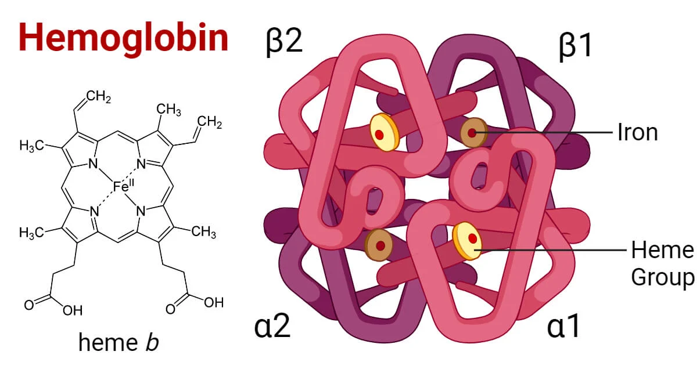

# HBB Gene Mutation Analysis

From genetic variant to protein: a pipeline that follows mutations of the human **HBB** gene (hemoglobin subunit beta) to their effect on the protein, and a starting point for studying how those changes alter protein structure.

**Published:** Anja Radomirović, *Machine Learning Classification of Hemoglobin Beta Gene Mutations*, CS & IT (CSCP 2026), AIRCC Publishing Corporation, pp. 75-93. DOI: [10.5121/csit.2026.160106](https://doi.org/10.5121/csit.2026.160106) · [PDF](https://aircconline.com/csit/papers/vol16/csit160106.pdf)

## Why This Matters

**Proteins are the machines of living organisms.** They carry oxygen, speed up chemical reactions, build tissues and defend the body. Genes are the instructions for building them, so a mutation can change the machine that is made from it, and finding such mutations is a central task of modern biology and medicine.

**Hemoglobin is a clear example.** It carries oxygen in blood and is built from four chains, each holding a heme group with an **iron atom** at its center, which is where oxygen binds. HBB encodes the beta chain, and its mutations cause diseases such as sickle cell disease and beta thalassemia, which can come from a change of a single amino acid.



**A sequence of amino acids says little without the shape of the protein.** A protein works because of how its chain folds in three dimensions. Two sequences that differ by one amino acid can look almost identical as text, yet fold differently, and the shape decides whether the protein works. In hemoglobin the question is concrete: the iron atom sits in a pocket held in place by specific residues, so a small geometric or topological change around it could affect how well iron and oxygen are bound.

## Where This Work Should Go Next

The most valuable continuation is a **3D structural analysis**: comparing the structure of the normal and the mutated protein and looking for geometric and topological changes, especially around the heme pocket and the iron atom. That is where it becomes possible to say *why* a mutation matters, not only that it exists, and whether the protein remains compatible with the iron it must bind.

## The Work in Brief

The pipeline processes **1,809 HBB variants** from ClinVar: it builds the mutated mRNA for each one (including splicing effects predicted with SpliceAI), translates it into a protein and compares it with the reference. On this data, seven classifiers, including neural networks, were compared for predicting pathogenic versus benign variants.

Machine learning was the framing of the project, and much of the effort went into comparing models, which was not strictly necessary for its main goal. The results show the limits of predicting pathogenicity from the amino acid sequence alone, which is exactly why structure is the missing piece. The lasting value is the data foundation: a reproducible path from ClinVar variants to mutated protein sequences, ready for deeper analysis. The paper above describes the full method and its limitations.

## Technical Details

**Stack:** Python 3.12 · Biopython · pandas · NumPy · scikit-learn · imbalanced-learn · XGBoost · matplotlib · seaborn
**Data sources:** NCBI (RefSeq, ClinVar) and Ensembl (REST API, VEP/SpliceAI)

```bash
git clone https://github.com/anjaradomirovic/hbbGeneMutation.git
cd hbbGeneMutation
pip install -r requirements.txt
export NCBI_EMAIL="your.email@example.com"   # NCBI asks for a contact address
python main.py
```

An internet connection is needed on the first run. Intermediate files are cached in `data/`, so later runs skip finished steps.

## Author

**Anja Radomirović**: [GitHub](https://github.com/anjaradomirovic)
